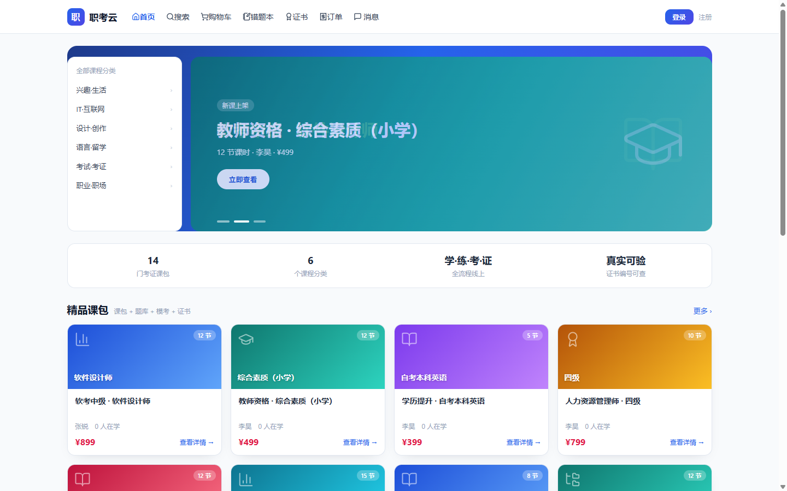
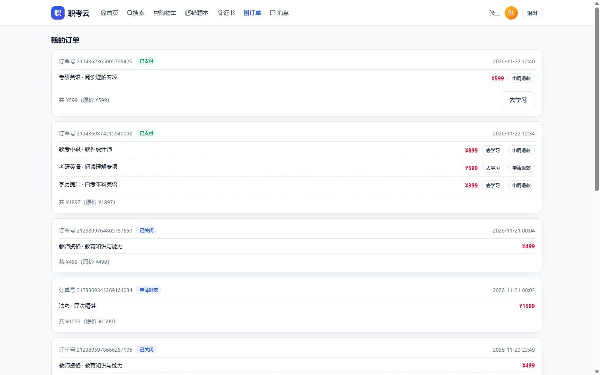
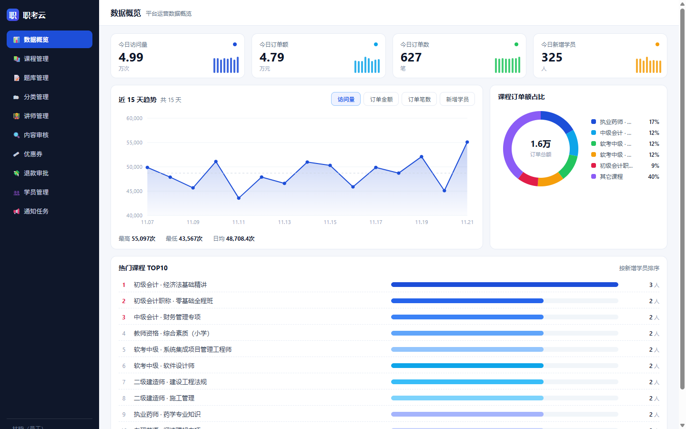

# 职考云 · 职业技能考证平台

> 学 · 练 · 考 · 证 一体化的在线考证平台：Spring Cloud Alibaba 微服务，**15 个微服务 + 2 个公共模块**（`zk-common` / `zk-api`）。
> 核心闭环：学（学时累计）→ 练（错题本按考点聚合）→ 考（题库模考判分）→ 证（资格判定、签发、验真、到期复证）。

[架构图（可交互）](docs/diagrams/zhikaoyun-architecture.html)


## 界面预览

| 学员端首页（分类导航 + 轮播） | 我的订单（按课程聚合） | 管理端数据看板 |
|---|---|---|
|  |  |  |

> 截图为 2026-10 的实跑画面（Chrome 无头，1440×900）。学员端 13 个页面、管理端 10 个模块的完整截图见
> [`docs/mockup/e2e2/`](docs/mockup/e2e2/)，逐条联调报告见 [`web/README.md`](web/README.md#前后端联调测试)。

---

## 1. 技术栈

| 分类 | 选型 |
|---|---|
| 框架 | Spring Boot 2.7.2 · Spring Cloud 2021 · Spring Cloud Alibaba 2021 |
| 注册/配置 | Nacos（注册 + 9 个 `shared-*.yaml` 共享配置：feign / logs / mybatis / redis / mq / mongo / seata / spring / xxljob） |
| 数据 | MySQL 8（14 个业务库、66 张表）· MyBatis-Plus · MongoDB（考试记录） |
| 缓存 | Redis + Redisson（分布式锁、缓存） |
| 消息 | RabbitMQ（事件驱动：答题、发证、通知） |
| 搜索 | Elasticsearch 7.12（课程检索） |
| 调度 | XXL-Job（到期复证提醒、发证补偿） |
| 事务 | Seata（AT 模式已接入，但主链路未启用，走最终一致 + 补偿；见 [docs/未实现清单.md](docs/未实现清单.md)） |
| 文档 | Knife4j（网关聚合 + 单服务文档） |

## 2. 服务与端口

| 服务 | 端口 | 职责 |
|---|---|---|
| `gateway-service` | 10010 | 路由、JWT 鉴权、文档聚合 |
| `auth-service` | 8081 | 登录、JWT、RBAC |
| `user-service` | 8082 | 学员 / 教师 / 员工 |
| `search-service` | 8083 | ES 课程检索 |
| `media-service` | 8084 | 图片、COS/VOD |
| `message-service` | 8085 | 站内信、短信 |
| `course-service` | 8086 | 课包、目录、分类、师资 |
| `pay-service` | 8087 | 支付、退款 |
| `trade-service` | 8088 | 购物车、订单 |
| `exam-service` | 8089 | 题库、考试、判分、**错题本** |
| `learning-service` | 8090 | 课表、学习记录、**学时统计**、积分 |
| `cert-service` | 8091 | **证书：签发 / 验真 / 到期复证**（新增） |
| `remark-service` | 8092 | 点赞、互动 |
| `data-service` | 8093 | 数据看板 |
| `promotion-service` | 8094 | 优惠券、促销 |

## 3. 四个关键设计

### 3.1 发证幂等：唯一索引兜底，不是 `if`

`certificate` 表有 `uk(user_id, exam_id)`。并发下"先查后插"挡不住重复，唯一索引才是互斥；冲突后回查返回既有证书。

### 3.2 证书编号：Redis 号段 + 唯一索引双保险

`INCR zk:cert:seq:{year}` 生成 `ZK-2026-000137`，DB 唯一索引兜住 Redis 重启后的序号回退，冲突换号重试。

### 3.3 考试通过自动发证：最终一致

```
交卷判分(score ≥ 60 且是正式考)
  → 调 learning-service 查学时（已完成小节时长求和）
  → 发 MQ：cert.topic / cert.issue
  → cert-service 消费：学时 ≥ 120 且成绩 ≥ 60 → 签发
  → 失败落 cert_task，XXL-Job 补偿重放
```
发证失败**不影响交卷**，两边最终一致。

### 3.4 错题本：一题一条，答对自动掌握

`uk(user_id, question_id)` + `ON DUPLICATE KEY UPDATE wrong_count+1`。
重练答对时把该题置为已掌握——错题本会自己变短。

## 4. 实测数据

| 项 | 结果 |
|---|---|
| 并发发证（同一场考试 500 次） | 只产生 **1 张证**，编号唯一 |
| 并发发证（300 个不同考试） | **300 张证 / 300 个唯一编号**，P99 508ms |
| 端到端 | 学时 211 分钟 + 正式考 90 分 → `ZK-2026-000005` → 验真 `valid=true` |
| 错题本 | 18 题模考错 16 题 → 按考点聚合 → 重练全对后自动掌握 16 条 |

压测报告见 [docs/perf.md](docs/perf.md)。

## 5. 本地启动

**不需要 Jenkins。** 课程环境那套 Jenkins（`jenkins.zkxt.com` 上 `zkxt-*` 的 job）构建的是改名前的代码和 `zkxt-*` 镜像，
现在用下面三段就够了。依赖中间件（Nacos / MySQL / Redis / RabbitMQ / MongoDB / ES）跑在 `192.168.150.101` 上，
只需保证这些容器在运行。

```powershell
# 1) 编译（首次或改了后端代码后）—— 约 2 分钟
mvn -T 1C -DskipTests package

# 2) 起全部 15 个服务（日志写到 logs\<服务>.log，不再污染根目录）
powershell -ExecutionPolicy Bypass -File tools\start-all.ps1
#    只起几个：  ... -File tools\start-all.ps1 -Only user,auth,gateway

# 3) 停全部服务（只杀 zk-*.jar 的 java 进程，不影响 IDEA）
powershell -ExecutionPolicy Bypass -File tools\stop-all.ps1
```

单独起某个服务（调试用）：

```powershell
powershell -File tools\run-service.ps1 course
```

> 脚本已内置 JDK 17 需要的 `--add-opens` 和 `-Dfile.encoding=UTF-8`，以及本机联调用的 `-DiscoveryIp 127.0.0.1`。
> 端口一览见上面第 2 节；`data-service` 启动较慢（约 2 分钟），属正常。

接口文档：`http://localhost:10010/doc.html`（网关聚合）或单服务 `http://localhost:<port>/doc.html`。

### 前端（web/）

```bash
cd web
pnpm install    # 首次（仓库里有 pnpm-lock.yaml；用 npm install 也能跑）
pnpm dev        # http://127.0.0.1:5173
```

Vue 3 + Vite，**13 个学员端页面 + 管理后台**全部调真实接口（登录 / 首页 / 搜索 / 购物车 / 课程详情 / 学习（内含小节笔记与问答）/ 答题 / 证书 / 错题本 / 订单支付 / 退款 / 消息 / 个人中心），详见 [web/README.md](web/README.md)。
> 演示账号 `jack` / `123456`；也支持**注册/找回密码**（`/register`、`/forgot`），验证码走 user-service 生成的 4 位码（Redis 5 分钟），无短信网关时打印到 `logs/user.log`；短信**登录**入口已移除。
> 联调脚本：`node tools/e2e_full.mjs`（13）+ `node tools/e2e_ui2.mjs`（10）+ `node tools/e2e_auth.mjs`（4）+ `node tools/e2e_admin.mjs`（12）+ `node tools/e2e_admin_write.mjs`（9）+ `python tools/smoke_all.py`（25）全过。
> 管理后台：<http://127.0.0.1:5173/admin/login>（**独立登录页**，员工账号 `admin` / `123456`），含 10 个模块（看板/课程/题库/分类/讲师/内容审核/优惠券/退款审批/学员/通知）。
> 两端登录接口互斥：`/as/accounts/login` 拒绝员工（`非学生端用户`），`/as/accounts/admin/login` 拒绝学员（`非管理端用户`）。

## 5.5 CI/CD（Gogs + Jenkins + Docker）

代码托管在 Gogs（课程环境 `git.zkxt.com`），并镜像到 GitHub（[Tian-917/zkxt](https://github.com/Tian-917/zkxt)）。Jenkins 流水线 zkxt-pipeline 自动完成「拉代码 → Maven 打包 → 构建镜像 → 部署到虚拟机 Docker → 冒烟」，与课程原来的 `j-*` 任务完全隔离（独立视图 职考云）。详见 [docs/CI-CD.md](docs/CI-CD.md)。

## 6. 种子数据

| 脚本 | 内容 |
|---|---|
| [tools/seed/gen_seed.py](tools/seed/gen_seed.py) | 14 个考证课包、168 条考点目录、题库改写 |
| [tools/seed/gen_teachers_questions.py](tools/seed/gen_teachers_questions.py) | 4 位讲师、30 道考证题、14 条报名 |
| [tools/seed/gen_study_records.py](tools/seed/gen_study_records.py) | 学时数据（已完成小节） |
| [tools/seed/sync_es.py](tools/seed/sync_es.py) | 同步 ES 课程索引 |

## 7. 冒烟与压测脚本

| 脚本 | 用途 |
|---|---|
| [tools/flow_smoke.py](tools/flow_smoke.py) | 正式考 → 自动发证 → 验真（一条命令跑通） |
| [tools/wrong_smoke.py](tools/wrong_smoke.py) | 练习 → 错题入库 → 重练掌握 |
| [tools/load_cert.py](tools/load_cert.py) | 证书接口并发压测 + 库校验 |
| [tools/cert_smoke.py](tools/cert_smoke.py) | 发证 / 幂等 / 资格校验 / 验真 |

## 8. 文档

- [架构图（可交互）](docs/diagrams/zhikaoyun-architecture.html)
- [证书域设计](docs/证书域设计.md) / [错题本设计](docs/错题本设计.md)
- [前端原型](docs/mockup/zhikaoyun-ui-preview.png) / [前端实跑截图](docs/mockup/e2e2/)（学员端 13 页 + 管理端 10 模块）

## 快速开始

本机开发（推荐，细节见第 5 节）：JDK 11、Maven 3.8+、Node 18+；Nacos / MySQL / Redis / RabbitMQ / MongoDB / ES 跑在 `192.168.150.101` 上，不需要本机装中间件。

```bash
# 1. 编译并起全部 15 个服务
mvn -T 1C -DskipTests package
powershell -ExecutionPolicy Bypass -File tools\start-all.ps1

# 2. 库表与种子数据（首次）：把 docs/sql/ 下的脚本按服务导入
#    auth_privilege.sql / cert.sql / wrong_question.sql / note.sql /
#    seed-cert-platform.sql / seed-study-records.sql / seed-teachers-questions.sql /
#    xxl_job_init.sql / xxl-job-cert.sql

# 3. 前端（开发模式，热更新）
cd web && pnpm install && pnpm dev     # http://127.0.0.1:5173
```

本机访问：学员端 <http://127.0.0.1:5173>，管理端 <http://127.0.0.1:5173/admin/login>，接口文档 <http://localhost:10010/doc.html>。

容器化部署（课程环境的虚拟机，可选）：Jenkins 流水线 `zkxt-pipeline` 或 `bash docker/deploy.sh` 起 15 个容器，再用 `docker/setup-nginx.sh` 配好域名：

| 入口 | 地址 |
|---|---|
| 学员端 | http://www.zkxt.com |
| 管理端 | http://manage.zkxt.com |
| 接口文档 | http://api.zkxt.com/doc.html |

测试账号：学员 `jack / 123456`，管理端 `admin / 123456`。

## 9. 密钥与环境变量

仓库里**不含任何真实密钥**，全部走环境变量占位符（缺省为空，服务照常启动，只是对应能力不可用）：

| 变量 | 用途 | 缺失后果 |
|---|---|---|
| `TENCENT_APP_ID` / `TENCENT_SECRET_ID` / `TENCENT_SECRET_KEY` / `TENCENT_VOD_URL_KEY` | 腾讯云 COS/VOD | 视频上传、播放签名不可用 |
| `ALIPAY_APP_ID` / `ALIPAY_MERCHANT_PRIVATE_KEY` / `ALIPAY_PUBLIC_KEY` | 支付宝 | 支付宝下单不可用 |
| `WXPAY_APP_ID` / `WXPAY_MCH_ID` / `WXPAY_MCH_SERIAL_NO` / `WXPAY_PRIVATE_KEY` / `WXPAY_API_V3_KEY` | 微信支付 | 微信下单不可用（启动已做失败降级） |
| `SMS_ACCESS_ID` / `SMS_ACCESS_SECRET` | 阿里云短信 | 短信不可用，站内信正常 |

> 历史版本曾在 `bootstrap.yml` 里硬编码过真实密钥。**这些密钥必须去各平台吊销/重置**，
> 仅从代码里删除是不够的（已泄漏的凭证随时可用）。

### 没有凭证也能完整演示

个人开发者拿不到商户号/云账号，所以这几处都做了**无凭证降级**，不影响功能演示：

| 能力 | 无凭证时的行为 |
|---|---|
| 支付 | 内置 `mock` 渠道：`POST /ts/pay/order` 返回 `mock://pay?...`，再调 `POST /ps/pay-orders/{bizOrderNo}/mock-pay` 即视为支付成功，会照常发 `PAY_SUCCESS` 消息、订单状态流转、自动报名 |
| 文件上传 | `zk.platform.file=LOCAL` → 落本地 `./uploads` 目录（`LocalFileStorage`，与云存储同一套 `IFileStorage` 接口） |
| 短信 | 未配置 `zk.sms.ali.accessId` 只打 WARN 日志、不抛异常；站内信不受影响 |
| 视频播放 | 前端用模拟播放器演示进度上报；云 VOD 签名接口在无凭证时不保证可播 |


## 10. 已知限制

- 前端已接真实登录鉴权（JWT + 路由守卫 + 401 自动续期），但只做到路由级：按钮/字段级权限未细分
- 视频播放器为占位（模拟播放驱动进度与学时），没有真实媒资
- 讲师信息、课程富文本为种子数据，非真实运营内容
- 考点粒度 = 小节，未建独立知识点表
- 发证同键高并发时 P99 会升高（唯一索引热点行），优化方向见 `docs/perf.md`
- README 里的截图是 2026-10 的实跑画面，改 UI 后需重跑 `tools/e2e_*.mjs` 才会更新
